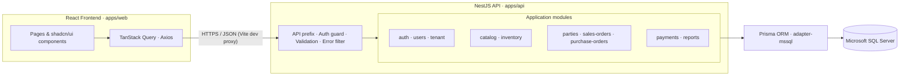

<div align="center">

# 📦 TradeFlow

### Bilingual B2B wholesale management — from stock to statement.

TradeFlow helps wholesalers run their day-to-day trade with retailers: products and stock,
customers and suppliers, sales and purchase orders, payments and running balances —
in **Arabic (RTL)** or **English (LTR)**.

<br />


<br />


<br />

[About](#-about-tradeflow) ·
[Features](#-key-features) ·
[Tech Stack](#-technology-stack) ·
[Architecture](#-architecture-overview) ·
[Getting Started](#-getting-started) ·
[API](#-api-overview) ·
[Status](#-project-status)

</div>

---

## 💡 About TradeFlow

Wholesalers often juggle spreadsheets, paper invoices and memory to answer simple questions:
*How much stock is left? Who owes us money? What do we owe our suppliers?*

TradeFlow brings those answers into one place. Each business gets its own isolated workspace
where the team can:

- keep a **live stock ledger** that is updated automatically by sales and purchases,
- price products per customer and track **credit limits**,
- move orders through a clear lifecycle with **per-business document numbers** (`SO-00001`, `PO-00001`),
- record payments that are **voidable but never deleted**, and
- read every customer and supplier balance as a **ledger-style statement** with a running balance.

> [!NOTE]
> TradeFlow is a portfolio project, built independently. It is not a commercial product.

---

## ✨ Key Features

<table>
<tr>
<td width="50%" valign="top">

#### 🏷️ Products & Categories
SKU, unit, cost and wholesale price, reorder level and opening stock. Search and filter by category, status or low stock.

#### 📊 Inventory
Stock movement ledger (opening, sale, cancellation, purchase receipt, adjustment), low-stock highlighting and manual adjustments with a reason. Stock can never go negative.

#### 👥 Customers
Credit limit warnings, customer-specific prices and a full account statement.

#### 🧾 Sales Orders
`DRAFT → CONFIRMED → DELIVERED` (or `CANCELLED`). Stock is deducted atomically on confirm and restocked on cancel. Live totals with discount and VAT.

</td>
<td width="50%" valign="top">

#### 💳 Customer Payments
Record payments against a specific order or on account, with outstanding-amount checks. Payments can be voided with a reason and are never deleted.

#### 🚚 Suppliers & Purchase Orders
Supplier records with "you owe" balances and a ledger statement. Purchase orders go `DRAFT → ORDERED → RECEIVED` (or `CANCELLED`); receiving adds stock and updates the product cost. Supplier payments share the customer payments flow.

#### 📈 Dashboard & Reports
Sales, receivables and low-stock overview with charts. Reports cover sales and gross profit for any period, inventory value at cost, customer and supplier balances, and recent activity. Staff see a reduced dashboard without costs, profit or payables.

#### 🔐 Auth, Roles & Tenancy
Self-service sign-up creates an isolated business. **Owner / Manager / Staff** roles are enforced by the API; every business row is scoped to its tenant at the database level. Owners manage users and business settings; everyone can change their own password.

</td>
</tr>
</table>

### Feature availability

| Feature | Backend API | Web UI |
|---|:---:|:---:|
| Authentication (sign up, sign in, token refresh) | ✅ | ✅ |
| Dashboard | ✅ | ✅ |
| Products & categories | ✅ | ✅ |
| Inventory & stock adjustments | ✅ | ✅ |
| Customers, special prices & statements | ✅ | ✅ |
| Sales orders | ✅ | ✅ |
| Customer payments | ✅ | ✅ |
| Suppliers & statements | ✅ | ✅ |
| Role-based access control | ✅ | ✅ |
| Multi-tenant data isolation | ✅ | — |
| Arabic & English localization | — | ✅ |
| Purchase orders | ✅ | ✅ |
| Supplier payments | ✅ | ✅ |
| Reports (sales, inventory value, balances, activity) | ✅ | ✅ |
| Business settings | ✅ | ✅ |
| User management | ✅ | ✅ |
| Change password | ✅ | ✅ |

<sub>✅ Available &nbsp;·&nbsp; — Not applicable</sub>

---

## 🧰 Technology Stack

<table>
<tr>
<th align="left">Backend</th>
<th align="left">Frontend</th>
</tr>
<tr>
<td valign="top">


- **NestJS** — backend framework (ESM)
- **Prisma ORM** with `@prisma/adapter-mssql`
- **Microsoft SQL Server** — the only supported database
- JWT access tokens + rotating httpOnly refresh cookies
- argon2 password hashing, Helmet, rate limiting
- class-validator DTOs with a strict validation pipe

</td>
<td valign="top">


- **React** — UI library, bundled with **Vite**
- **shadcn/ui** components on **Radix UI** primitives (RTL-aware)
- **TanStack Query** for server state
- **React Hook Form + Zod** for forms and validation
- **react-i18next** for Arabic / English
- Recharts, Sonner, Lucide icons, IBM Plex Sans Arabic

</td>
</tr>
<tr>
<th align="left" colspan="2">Architecture & Tooling</th>
</tr>
<tr>
<td colspan="2">


</td>
</tr>
</table>

---

## 🏗️ Architecture Overview

TradeFlow is a **modular monolith**: one deployable API, split into feature modules with clear ownership.
Cross-cutting rules live in a single place — for example, `StockService` is the only writer of stock
quantities, and `LedgerService` is the only definition of balances and statements.



<details>
<summary><b>Module responsibilities</b></summary>

<br />

| Module | Responsibility |
|---|---|
| `auth` | Sign up (creates a tenant + owner), sign in, refresh-token rotation, sign out, change password |
| `users` | Owner-only user management and password resets |
| `tenant` | Business profile: name, currency, default VAT % |
| `catalog` | Categories and products |
| `inventory` | Stock movements and manual adjustments (`StockService`) |
| `parties` | Customers, customer-specific prices, suppliers and their statements |
| `sales-orders` | Draft editing, confirm / deliver / cancel with stock effects |
| `purchase-orders` | Draft editing, order / receive / cancel; receiving adds stock and updates cost |
| `payments` | Customer and supplier payments, voiding, balances (`LedgerService`) |
| `reports` | Dashboard and sales, inventory, balances and activity reports |

</details>

<details>
<summary><b>Multi-tenancy & security design</b></summary>

<br />

- **Shared database, tenant-scoped rows.** Every business row carries a `tenantId` taken from the verified JWT — never from request input.
- **Composite foreign keys** `(tenantId, xId) → (tenantId, id)` make SQL Server itself reject cross-tenant links.
- Records from other tenants always answer **404**.
- Short-lived access tokens are kept in memory; refresh tokens are stored hashed, sent as an httpOnly `SameSite=Strict` cookie, rotated on every use, and replay of a rotated token revokes the whole session family.
- Roles are enforced in the API; the web app only mirrors them (hidden navigation, role-gated routes).
- Errors return a stable `code` that the web app translates, without leaking internals.

</details>

<details>
<summary><b>Data integrity rules</b></summary>

<br />

- Stock is deducted on **confirm** with an atomic conditional update, backed by a `CHECK (stock >= 0)` constraint.
- Money is `DECIMAL(14,2)`, computed with Prisma Decimal and rounded half-up; the web editor previews totals with an exact integer-cents mirror of the server formula.
- Payments linked to an order cannot exceed its outstanding amount (row-locked).
- Statements replay events with a running balance that always equals the balance formula.
- Database CHECK constraints cover prices, quantities, payment amounts, discounts and enum values.

</details>

---

## 🖼️ Screenshots

Screenshots of the dashboard, ledger statements and the Arabic / English layouts are not added yet.

---

## 📁 Project Structure

```text
tradeflow/
├── apps/
│   ├── api/                      # NestJS REST API
│   │   ├── prisma/
│   │   │   ├── schema.prisma     # SQL Server data model
│   │   │   ├── migrations/
│   │   │   └── seed.ts           # Demo business
│   │   ├── scripts/              # Smoke test & test-DB helpers
│   │   ├── src/
│   │   │   ├── common/           # Auth guard, errors, money, pagination, tx helpers
│   │   │   ├── modules/          # auth, users, tenant, catalog, inventory, parties,
│   │   │   │                     # sales-orders, purchase-orders, payments, reports
│   │   │   ├── app.module.ts
│   │   │   └── main.ts
│   │   ├── test/                 # e2e suites: auth, RBAC, tenancy, workflows
│   │   └── .env.example
│   └── web/                      # React + Vite SPA
│       └── src/
│           ├── auth/             # Session context, role gate
│           ├── components/       # Shared components + shadcn/ui
│           ├── i18n/locales/     # ar/ and en/ JSON namespaces
│           ├── layout/           # App shell & navigation
│           ├── lib/              # API client, types, formatting, order math
│           ├── pages/            # Feature pages
│           └── router.tsx
└── package.json                  # npm workspaces root
```

---

## 🚀 Getting Started

### Prerequisites

| Requirement | Notes |
|---|---|
| **Node.js ≥ 22** | with npm 11 |
| **Microsoft SQL Server 2019+** | TCP/IP enabled on port `1433` and **mixed-mode (SQL) authentication** |
| **sqlcmd** or SSMS | to create the login and databases |

> [!IMPORTANT]
> TradeFlow runs directly on your machine — there is no Docker setup.

### 1. Clone and install

```bash
git clone https://github.com/ali-kassab/tradeflow.git
cd tradeflow
npm install        # also generates the Prisma client
```

### 2. Prepare SQL Server

Connect as a sysadmin (for example `sqlcmd -S localhost -E -C`) and create a login plus three databases.
Choose your own strong password.

<details>
<summary><b>Example T-SQL</b></summary>

```sql
CREATE LOGIN tradeflow WITH PASSWORD = '<choose-a-strong-password>';
GO
CREATE DATABASE tradeflow;         -- development
CREATE DATABASE tradeflow_test;    -- e2e tests (wiped on every run)
CREATE DATABASE tradeflow_shadow;  -- used by `prisma migrate dev` only
GO
USE tradeflow;        CREATE USER tradeflow FOR LOGIN tradeflow; ALTER ROLE db_owner ADD MEMBER tradeflow;
USE tradeflow_test;   CREATE USER tradeflow FOR LOGIN tradeflow; ALTER ROLE db_owner ADD MEMBER tradeflow;
USE tradeflow_shadow; CREATE USER tradeflow FOR LOGIN tradeflow; ALTER ROLE db_owner ADD MEMBER tradeflow;
GO
```

</details>

### 3. Configure the environment

```bash
cp apps/api/.env.example apps/api/.env
```

Then edit `apps/api/.env`:

| Variable | Purpose |
|---|---|
| `DATABASE_URL` | Development database connection string |
| `SHADOW_DATABASE_URL` | Shadow database for `prisma migrate dev` |
| `TEST_DATABASE_URL` | e2e test database (name must contain `test`) |
| `JWT_ACCESS_SECRET` | Random secret for signing access tokens |
| `JWT_ACCESS_TTL`, `REFRESH_TOKEN_TTL_DAYS` | Token lifetimes |
| `CORS_ORIGINS` | Allowed browser origins |
| `PORT`, `NODE_ENV` | API port and environment |

Connection strings use the SQL Server format:

```text
sqlserver://localhost:1433;database=tradeflow;user=tradeflow;password=<your-password>;encrypt=true;trustServerCertificate=true
```

A secure JWT secret can be generated with:

```bash
node -e "console.log(require('crypto').randomBytes(48).toString('base64url'))"
```

> [!CAUTION]
> Never commit `apps/api/.env`. It is already listed in `.gitignore`.

### 4. Migrate and seed

```bash
npm run db:deploy -w @tradeflow/api   # apply migrations
npm run db:seed                       # optional: fictional demo business
```

The seed creates a demo business with three accounts — `owner@`, `manager@` and `staff@demo.tradeflow.local` —
whose demo-only password is defined in [`apps/api/prisma/seed.ts`](apps/api/prisma/seed.ts).

### 5. Run in development

```bash
npm run dev
```

| Service | URL |
|---|---|
| Web app | http://localhost:5173 (proxies `/api` to the API) |
| API | http://localhost:3000/api |
| Swagger docs (non-production) | http://localhost:3000/api/docs |

<details>
<summary><b>All scripts</b></summary>

<br />

| Command | Description |
|---|---|
| `npm run dev` | Start API and web app together |
| `npm run build` | Build API and web app |
| `npm test` | API unit tests, API e2e tests, web unit tests |
| `npm run db:migrate` | Create / apply migrations in development (`prisma migrate dev`) |
| `npm run db:seed` | Seed the demo business |
| `npm run db:reset` | Reset the dev database and re-seed (**destructive**) |
| `npm run test:e2e -w @tradeflow/api` | e2e suites against `TEST_DATABASE_URL` |
| `npm run lint -w @tradeflow/api` / `-w @tradeflow/web` | Oxlint |
| `npm run typecheck -w @tradeflow/api` / `-w @tradeflow/web` | TypeScript checks |
| `node apps/api/scripts/smoke.mjs [baseUrl]` | Live smoke test as each demo role |

</details>

> [!TIP]
> On Windows, if PowerShell's execution policy blocks `npm.ps1`, run `npm.cmd` instead.

---

## 🔌 API Overview

All endpoints are served under `/api` and documented with Swagger at `/api/docs` in development.

| Area | Endpoints | Access |
|---|---|---|
| **Auth** | `POST register` · `login` · `refresh` · `logout` · `change-password`, `GET me` | Public / signed in |
| **Users** | `GET` · `POST` · `PATCH /:id` · `POST /:id/reset-password` | Owner |
| **Tenant** | `GET` · `PATCH` | All / Owner |
| **Categories** | CRUD | Write: Manager+ |
| **Products** | CRUD with `search`, `categoryId`, `status`, `lowStock` filters | Write: Manager+ |
| **Inventory** | `GET movements` · `POST adjustments` | Adjust: Manager+ |
| **Customers** | CRUD · `/:id/statement` · `/:id/prices` (`GET`, `PUT`) | All roles (delete: Manager+) |
| **Suppliers** | CRUD · `/:id/statement` | Manager+ |
| **Sales orders** | CRUD (drafts) · `/:id/confirm` · `/deliver` · `/cancel` | All roles (cancel confirmed: Manager+) |
| **Purchase orders** | CRUD (drafts) · `/:id/order` · `/receive` · `/cancel` | Manager+ |
| **Payments** | `customer` and `supplier`: `GET` · `POST` · `POST /:id/void` | Void & supplier: Manager+ |
| **Dashboard & reports** | `GET dashboard` · `reports/sales` · `reports/inventory` · `reports/balances` · `reports/activity` | Reports: Manager+ |
| **Health** | `GET health` | Public |

<details>
<summary><b>Role permissions</b></summary>

<br />

| | Owner | Manager | Staff |
|---|:---:|:---:|:---:|
| Users, business settings | ✅ | ❌ | ❌ |
| Products / categories write, stock adjustments | ✅ | ✅ | ❌ (read only, no cost fields) |
| Customers create / edit | ✅ | ✅ | ✅ (no delete) |
| Sales orders create / confirm / deliver | ✅ | ✅ | ✅ |
| Cancel confirmed orders, price override, void payments | ✅ | ✅ | ❌ |
| Suppliers, purchase orders, supplier payments | ✅ | ✅ | ❌ |
| Reports | ✅ | ✅ | ❌ |
| Dashboard | Full | Full | Sales & receivables only |

</details>

---

## 🌍 Localization

| | Arabic | English |
|---|---|---|
| Direction | RTL | LTR |
| Default | ✅ | |
| Font | IBM Plex Sans Arabic (bundled, no CDN) | IBM Plex Sans Arabic |

- Built with **react-i18next**; translations live in `apps/web/src/i18n/locales/{ar,en}/` as per-feature namespaces, and a test checks that both languages have the same keys.
- Switching language updates `<html lang dir>` at runtime and is remembered in the browser.
- Layouts use logical Tailwind classes, and Radix primitives receive the direction through a provider, so menus, tabs and dialogs flip correctly.
- Numbers use Western digits in both languages; the default currency is EGP.
- API errors carry a stable `code` and are translated on the client.

---

## 📌 Project Status

> [!NOTE]
> The MVP is **feature-complete**: every API endpoint has a screen in the web app, in Arabic and English.

<table>
<tr>
<th>✅ Implemented</th>
<th>🗓️ Planned</th>
</tr>
<tr>
<td valign="top">

- Complete MVP REST API
- Multi-tenancy & RBAC
- SQL Server schema, migrations, seed
- API unit & e2e test suites
- Web: auth, dashboard, products, categories, inventory, customers, sales orders, customer payments, suppliers, purchase orders, supplier payments, reports, settings, users
- Arabic / English with RTL / LTR, responsive down to phone width

</td>
<td valign="top">

- Screenshots in this README

</td>
</tr>
</table>

---

## 🔭 Future Improvements

- Docker-based local setup
- Continuous integration for linting, type checks and tests
- Export statements and reports to PDF / Excel
- Returns, credit notes and partial deliveries
- Multiple warehouses
- Product images

---

## 📄 License

The workspace `package.json` declares the **MIT** license, but no `LICENSE` file has been added to the repository yet.

---

<div align="center">

<sub>Built with NestJS, React and SQL Server · Designed for Arabic and English from day one</sub>

<br />

<sub>Made by <a href="https://github.com/ali-kassab">ali-kassab</a></sub>

</div>
